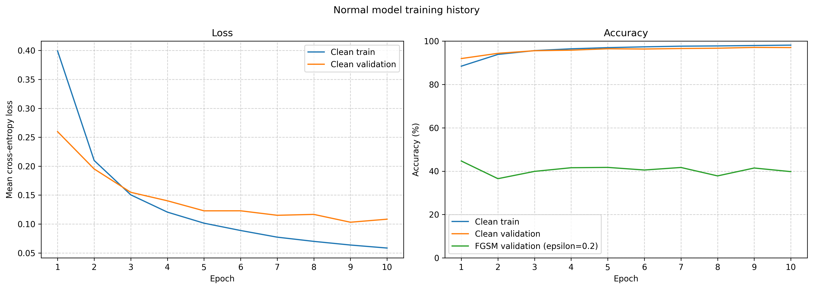
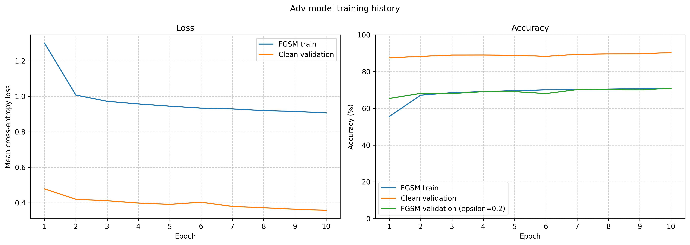
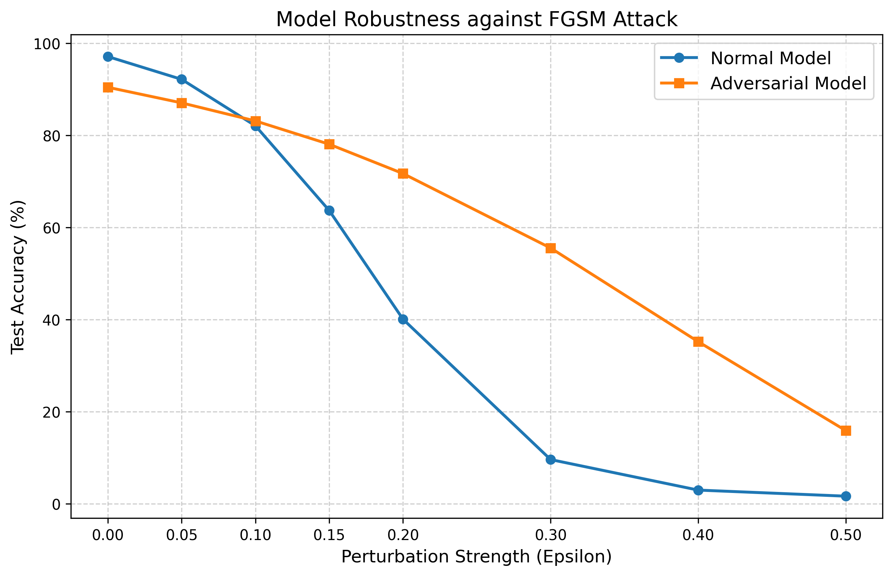
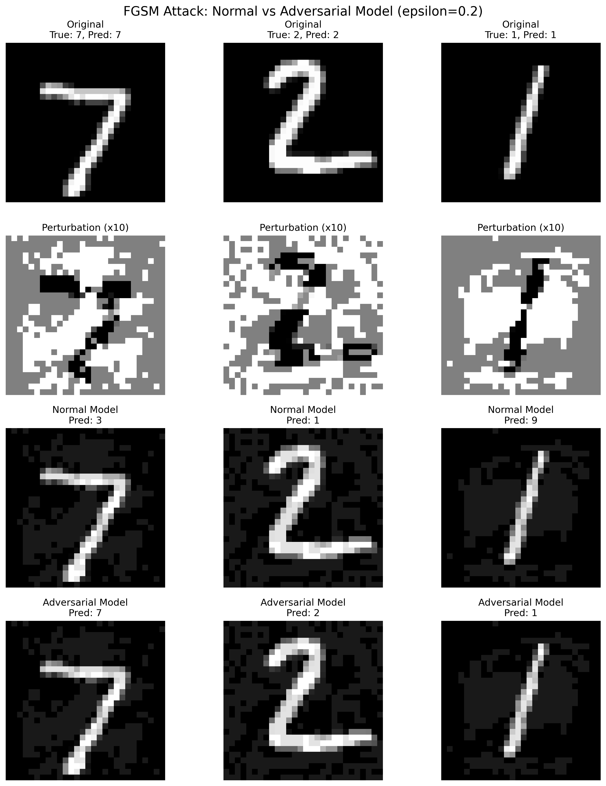

# FGSM 攻击与对抗训练对比（MNIST）

本项目在 MNIST 手写数字数据集上，实现非定向 FGSM 攻击，并比较普通训练与 FGSM 对抗训练的表现。训练脚本保存两组模型权重，案例可视化脚本加载同一组权重，避免重复训练。

## 实验设置

| 配置项 | 当前设置 |
| --- | --- |
| 数据集 | MNIST 原训练集按种子 42 划分为 54,000 张训练图片、6,000 张验证图片；另有 10,000 张测试图片 |
| 模型 | 全连接网络：Flatten → Linear(784, 128) → ReLU → Linear(128, 10) |
| 随机种子 | 42（Python、NumPy、PyTorch） |
| 训练轮数 | 普通模型与对抗模型各 10 轮（初步设置） |
| 训练批大小 | 64 |
| 优化器 | Adam，学习率 0.001 |
| 损失函数 | 交叉熵损失 |
| 对抗训练扰动强度 | ε = 0.2 |
| 曲线测试扰动强度 | 0、0.05、0.1、0.15、0.2、0.3、0.4、0.5 |
| 运行设备 | 优先使用 CUDA，无可用 GPU 时使用 CPU |

图片先转为 `[0, 1]` 的张量，再通过 `(x - 0.5) / 0.5` 归一化到 `[-1, 1]`。代码中的 ε 是归一化空间中的 L∞ 扰动上限：ε = 0.2 对应原始 `[0, 1]` 像素空间中的扰动上限 0.1。攻击后的图片裁剪到 `[-1, 1]`。

### 两种训练方式

- **普通模型**：只使用正常样本训练。
- **对抗模型**：独立初始化；每批使用当前模型和真实标签生成 FGSM 对抗样本，再仅根据对抗样本的分类损失更新参数。没有混合正常样本的训练损失，也不是在普通模型权重上继续微调。

FGSM 沿增大分类损失的方向对输入施加一次扰动，不指定某个错误类别作为目标。生成攻击时会计算梯度，但不更新模型参数；正式训练前清空参数梯度，再计算训练损失并更新参数。

## 实验结果

以下数值来自本次实际运行日志：随机种子 42，54,000 张图片用于训练、6,000 张用于验证，两个模型各训练 10 轮，使用 CUDA。测试结果对应第 10 轮结束后保存的权重，不是多次实验的均值，也不是根据验证指标选择的最佳轮次权重。

| 模型 | 正常图片准确率 | 白盒 FGSM 攻击下准确率（ε = 0.2） |
| --- | ---: | ---: |
| 普通模型 | 97.11% | 40.06% |
| 对抗模型 | 90.44% | 71.70% |

本次实验中，对抗模型在 FGSM 攻击下的准确率提高了 **31.64 个百分点**，正常图片准确率降低了 **6.67 个百分点**。准确率的分母是全部 10,000 张测试图片，不仅是模型原本分类正确的图片。

### 训练过程与收敛情况

每个 Epoch 的完整指标分别保存在 [普通模型日志](normal_training_log.csv) 和 [对抗模型日志](adv_training_log.csv) 中。第 10 轮指标如下，其中验证集与上方最终测试集是不同的数据集。

| 模型 | Train Loss | Train Accuracy | 干净 Validation Loss | 干净 Validation Accuracy | FGSM Validation Accuracy（ε = 0.2） |
| --- | ---: | ---: | ---: | ---: | ---: |
| 普通模型 | 0.0584 | 98.12% | 0.1083 | 97.00% | 39.78% |
| 对抗模型 | 0.9066 | 70.93% | 0.3580 | 90.35% | 70.95% |

普通模型的训练指标基于干净样本，对抗模型的训练指标基于 FGSM 样本，因此两行的 Train Loss 和 Train Accuracy 不能直接作为相同任务下的性能比较。两种模型的干净验证指标均基于同一验证集；FGSM 验证样本则分别针对各模型自身生成。



普通模型的训练 Loss 从 0.3992 降至 0.0584，后期干净验证准确率稳定在约 97%，表明已接近收敛。第 9 轮的干净验证 Loss 最低（0.1031），验证准确率为 97.07%；第 10 轮 Loss 回升至 0.1083，准确率为 97.00%。单轮回升不足以认定过拟合，仍需观察后续趋势。FGSM 验证准确率在训练过程中有波动，干净分类性能的提升没有带来持续的 FGSM 鲁棒性提升。



对抗模型的训练 Loss 从 1.2994 降至 0.9066，FGSM 验证准确率从 65.40% 升至 70.95%，干净验证准确率从 87.52% 升至 90.35%。后期改善速度放缓，但最后一轮的训练 Loss、干净验证 Loss 和两项验证准确率仍有改善，因此暂不能断言已经充分收敛。

### 鲁棒性曲线：分别针对各模型生成白盒攻击



对每个 ε，分别使用普通模型和对抗模型自身的梯度生成攻击，再评估各自的准确率，因此两个模型接受的对抗图片一般不同。ε = 0 时展示正常图片准确率。绘制曲线只进行评估，不重新训练模型。

### 案例图：两个模型预测同一张对抗图片



案例脚本仅针对普通模型生成 FGSM 攻击，再将同一张对抗图片输入两个模型。对普通模型而言是白盒攻击，对对抗模型而言是迁移攻击，与曲线中的攻击设置不同。两张图使用同一组模型权重，但展示不同的评估角度。

脚本在测试集第一批 1,000 张图片中，挑选同时满足以下条件的前 3 张：

1. 普通模型对原图预测正确。
2. 普通模型对对抗图片预测错误。
3. 对抗模型对这张对抗图片预测正确。

图中从上到下为原图、显示空间中放大 10 倍的扰动、普通模型对对抗图片的预测、对抗模型对同一张对抗图片的预测。扰动图使用统一且对称的灰度范围，零扰动显示为中灰。

这些是按条件筛选的展示案例，不能用来估计整体防御成功率。符合条件的案例不足 3 张时，其余列留空；没有符合条件的案例时脚本退出，不生成或覆盖图片，因此原有图片可能仍然保留。

## 项目文件

训练时每轮记录 Train Loss/Accuracy、干净 Validation Loss/Accuracy，以及 ε=0.2 的白盒 FGSM Validation Accuracy。Loss 为按样本数加权的平均交叉熵，Accuracy 单位为百分比，分母为相应数据集的全部样本数。

普通模型的训练指标基于干净样本，对抗模型的训练指标基于 FGSM 样本；验证 Loss 始终基于干净样本。训练指标在各批参数更新前累计，验证指标在整轮训练后计算，因此不能将两者的差值直接视为泛化差距。CSV 的 `train_input` 与 `epsilon` 列标注训练输入类型和扰动强度。

CSV 每轮写入并刷新，训练曲线在该模型训练结束后生成。结合 Loss 是否趋于平稳、验证准确率是否稳定，以及验证 Loss 是否反弹判断收敛或过拟合；10 轮并不保证充分收敛。测试集仅用于训练完成后的准确率对比及鲁棒性曲线，不用于逐轮监控。

| 文件或目录 | 作用 |
| --- | --- |
| `train_FGSM_ with_matplotlib.py` | 训练两个模型、保存权重、评估准确率并绘制鲁棒性曲线 |
| `FGSM_ normal_defense_visualize.py` | 加载两个模型的权重，生成并展示案例图，不进行训练 |
| `normal_model.pth` | 普通模型的参数字典 |
| `adv_model.pth` | 对抗模型的参数字典 |
| `normal_training_log.csv` / `adv_training_log.csv` | 两个模型各自的逐轮训练及验证指标 |
| `normal_training_curve.png` / `adv_training_curve.png` | 两个模型各自的 Loss 和 Accuracy 训练曲线 |
| `robustness_curve.png` | 不同攻击强度下的准确率曲线 |
| `attack_visualization.png` | 条件筛选后的攻击与预测案例 |
| `data/` | MNIST 数据集；训练脚本在缺少数据时下载 |

## 运行环境与方式

需要 Python、PyTorch、torchvision、NumPy 和 matplotlib。可以继续使用 VS Code 中已经配置好的 Anaconda `pytorch_env` 解释器，无需重复安装环境。

### 在 VS Code 中运行

1. 打开本项目文件夹，确认 Python 解释器为已安装 PyTorch 的 Anaconda 环境。
2. 打开 `train_FGSM_ with_matplotlib.py`，点击“运行 Python 文件”。每轮写入 CSV 日志；各模型训练结束后生成训练曲线，全部训练完成后保存两个 `.pth` 文件，再进行最终测试和鲁棒性曲线绘制。
3. 关闭弹出的曲线图窗口，等待脚本退出，再运行 `FGSM_ normal_defense_visualize.py`，生成案例图。

也可以在已激活对应环境的终端中依次运行，文件名含空格，请保留引号：

```powershell
python "train_FGSM_ with_matplotlib.py"
python "FGSM_ normal_defense_visualize.py"
```

以后仅重新生成案例图时，只需运行第二个脚本。缺少任意权重文件时，案例脚本会明确提示先运行训练脚本。

重新运行训练脚本会覆盖同名 CSV 日志、权重和曲线图，之后应重新生成案例图，确保案例图与鲁棒性曲线对应同一组模型。数据、日志、权重和输出图片均以脚本所在目录为基准，从其他目录启动也会使用相同路径。

### 权重保存与加载

- `model.state_dict()`：取得模型的参数字典，例如各层权重和偏置。
- `torch.save(model.state_dict(), path)`：把参数字典写入文件。
- `torch.load(path, map_location=device, weights_only=True)`：读取权重并映射到当前设备，支持在 CPU 上加载 GPU 保存的参数。
- `model.load_state_dict(...)`：把参数装入结构相同的模型。
- `model.eval()`：切换到评估模式，不会关闭 FGSM 所需的输入梯度计算。

当前 `.pth` 文件不包含优化器状态、训练轮数或完整实验配置，用于推理和可视化，而非完整恢复训练进度。修改网络结构后，旧权重可能无法加载；修改训练配置后，应重新训练并更新结果记录。

## 实验范围与后续方向

当前结果只反映这个全连接网络在所测 FGSM 设置下的表现，尚未验证 PGD 等更强攻击，不能据此认定模型具有普遍鲁棒性。固定随机种子有助于在相同环境下复现，但不保证跨设备或跨 PyTorch、CUDA 版本得到完全相同的结果。

后续可以加入 PGD 评估、CNN 模型，以及正常样本与对抗样本混合训练，并在一致的实验配置下比较结果。
